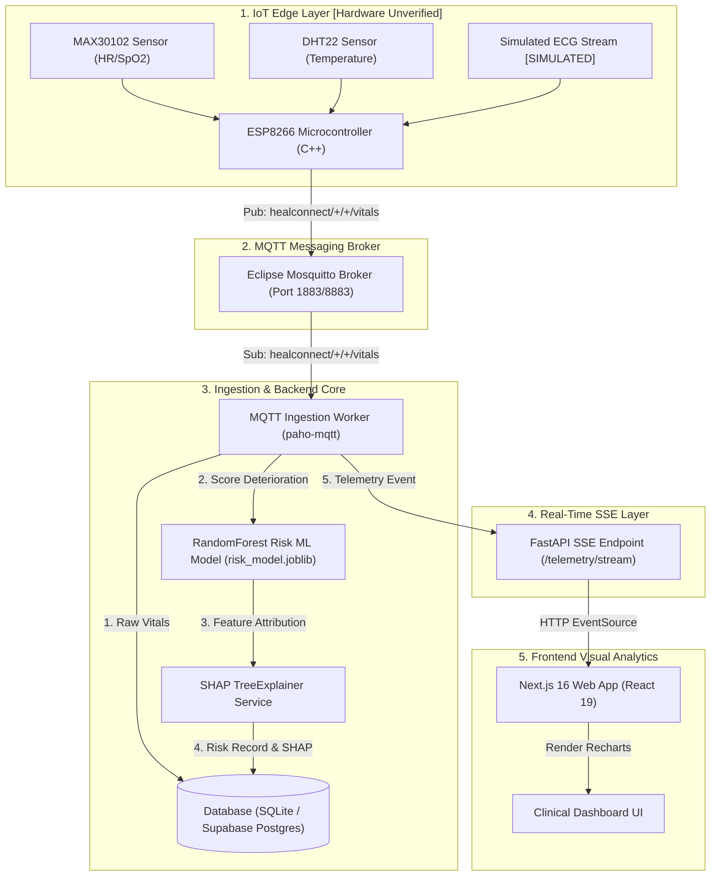

# 01 — Overall System Architecture

> **Path:** `architecture-project/01-overall-system-architecture.md`  
> **Status:** Code-Grounded Reference Architecture  

## Component Responsibilities & Connections

1. **IoT Edge Layer:** Reads physiological signals from MAX30102 and DHT22 via I2C and single-bus interfaces. Formats JSON telemetry payloads published over MQTT.
2. **MQTT Broker:** Eclipse Mosquitto handles publish/subscribe topic routing (`healconnect/{hospital}/{device}/vitals`) with QoS 1 delivery guarantees.
3. **MQTT Ingestion Worker:** Python `paho-mqtt` background service subscribing to broker topics, storing raw vitals into PostgreSQL/SQLite database, and triggering ML inference.
4. **Machine Learning & SHAP:** Executes `risk_model.joblib` (Random Forest, 94.59% accuracy) and `explain.py` for feature attribution scores.
5. **FastAPI SSE Broadcaster:** Maintains persistent `/telemetry/stream` connections to stream JSON events without polling.
6. **Next.js Frontend Client:** Consumes SSE stream via `EventSource`, updating Recharts graphs in real-time.
