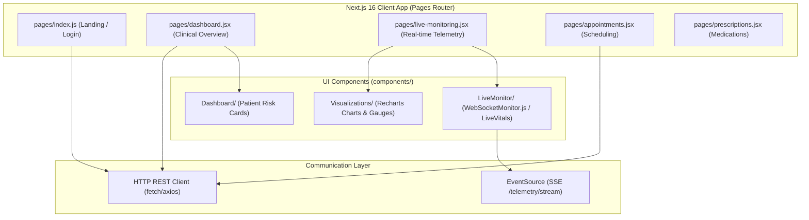

# 02 — Frontend Architecture

> **Path:** `architecture-project/02-frontend-architecture.md`  
> **Status:** Implemented & Compiled (Next.js 16.0.0 / React 19.0.0)  

## Component Breakdown
* **`pages/live-monitoring.jsx`:** Sub-second telemetry portal utilizing standard browser `EventSource` listening to `http://localhost:8000/telemetry/stream`.
* **`components/LiveMonitor/`:** Reusable React components rendering digital gauge readouts, vital status badges, and animated wave visualizers.
* **`components/Visualizations/`:** Recharts timeseries graphs (`^2.15.1`) displaying multi-parameter vitals history.
* **State Management:** Component-level React `useState` and `useEffect` hooks for dynamic UI reactivity.
