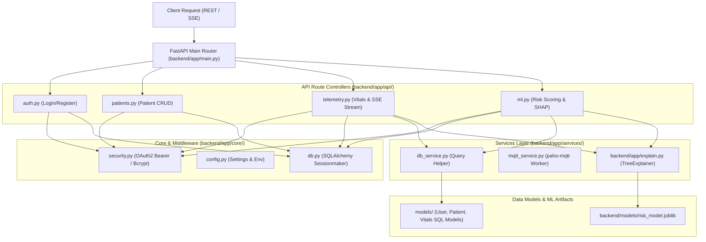

# 03 — Backend Architecture

> **Path:** `architecture-project/03-backend-architecture.md`  
> **Status:** Implemented & Verified (FastAPI 0.115.8 / 27 Pytest PASS)  

## Request Lifecycle
`Client Request` $
ightarrow$ `FastAPI Router` $
ightarrow$ `OAuth2 JWT Middleware` $
ightarrow$ `Route Controller` $
ightarrow$ `Service Layer` $
ightarrow$ `SQLAlchemy ORM / ML Model` $
ightarrow$ `JSON / SSE Response`.
