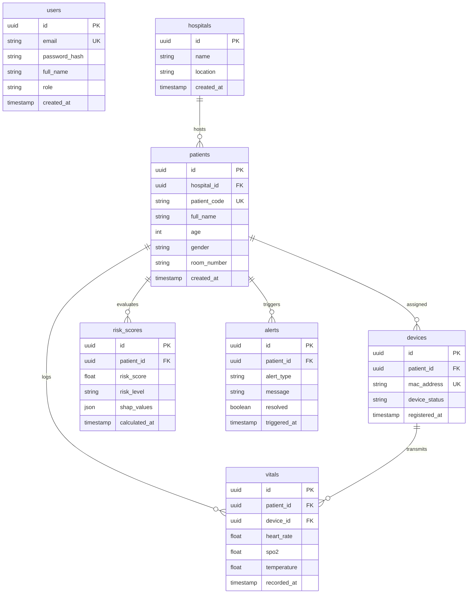

# 04 — Database Architecture

> **Path:** `architecture-project/04-database-architecture.md`  
> **Status:** Implemented & Verified (SQLAlchemy ORM / SQLite / Supabase PostgreSQL)  

## Schema & Tables Description
* **`users`:** Clinician accounts with bcrypt salted password hashes and role-based permissions (`doctor`, `nurse`, `admin`).
* **`patients`:** Clinical demographic records connected to hospital org nodes.
* **`vitals`:** High-frequency time-series log for telemetry measurements.
* **`risk_scores`:** Persisted outputs from `risk_model.joblib` and SHAP JSON feature attribution vectors.
