# 05 — Machine Learning Architecture

> **Path:** `architecture-project/05-ml-architecture.md`  
> **Status:** Implemented & Verified (RandomForest: 94.59% Acc, 0.9120 ROC-AUC / GradientBoosting: 96.58% Acc)  

```mermaid
flowchart TD
    subgraph Offline_Training["Offline ML Pipeline (ml/)"]
        DS1["cleaned_hospital_data.csv (167,146 samples)"] --> Pre1["preprocess.py (StandardScaler, Median Imputer)"]
        Pre1 --> Train1["train.py (RandomForestClassifier, n_estimators=100)"]
        Train1 --> Eval1["evaluate.py (ROC-AUC: 0.9120, Acc: 94.59%)"]
        Eval1 --> Joblib1["backend/models/risk_model.joblib"]

        DS2["disease_prediction_dataset.csv (15,000 samples)"] --> Train2["train_disease_model.py (GradientBoosting)"]
        Train2 --> Eval2["evaluate_disease_model.py (ROC-AUC: 0.9970, Acc: 96.58%)"]
        Eval2 --> Joblib2["backend/models/flu_model_v1.joblib"]
    end

    subgraph Online_Inference["Online Inference & XAI Pipeline"]
        InputData["14 Feature Vector (HR, SpO2, Temp, BP, Demographics)"] --> Scaler["risk_model_scaler.joblib"]
        Scaler --> Estimator["risk_model.joblib (predict_proba)"]
        Estimator --> RiskOutput["Risk Category (LOW, MODERATE, HIGH)"]
        Estimator --> SHAPService["backend/app/explain.py (shap.TreeExplainer)"]
        SHAPService --> SHAPVector["SHAP Feature Contributions JSON"]
    end

    subgraph Federated_Lab["Federated Learning & Privacy Sandbox (ml/ & exp_project/)"]
        FLClient["federated_client.py (Flower NumPyClient)"]
        FLServer["federated_server.py (FedAvg Aggregator)"]
        DPNoise["federated_differential_privacy.py (Laplace Noise Injection)"]
        FLClient --> FLServer
        DPNoise --> FLClient
    end
```

## ML Feature Inventory (14 Features)
`age`, `gender`, `heart_rate`, `spo2`, `temperature`, `sys_bp`, `dia_bp`, `respiratory_rate`, `gcs`, `wbcc`, `creatinine`, `lactate`, `heart_disease_history`, `diabetes_history`.
