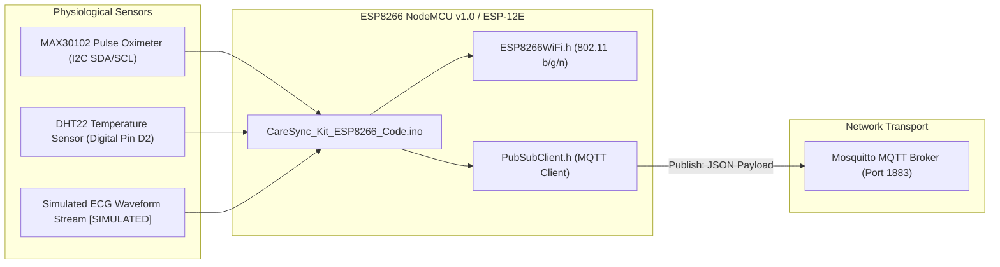

# 06 — IoT Edge Architecture

> **Path:** `architecture-project/06-iot-architecture.md`  
> **Status:** Firmware Implemented / PHYSICAL HARDWARE: NOT VERIFIED  

## Sensor Hardware Inventory

| Sensor Name | Parameter | Hardware Interface | GPIO Pin | Status |
| :--- | :--- | :--- | :--- | :--- |
| **MAX30102** | Heart Rate & SpO2 | I2C (`Wire.h`) | SDA (D2), SCL (D1) | Firmware Implemented (`Hardware Unverified`) |
| **DHT22 / DS18B20** | Body Temperature | Digital Single-Bus | GPIO 4 (D2) | Firmware Implemented (`Hardware Unverified`) |
| **ECG Stream** | Single-Lead ECG | Telemetry API | N/A | **SIMULATED** |
