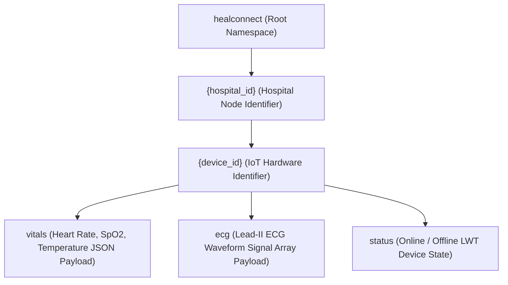

# 08 — MQTT Topic Hierarchy Architecture

> **Path:** `architecture-project/08-mqtt-topic-hierarchy.md`  
> **Status:** Implemented Topic Taxonomy  

## Topic Wildcard Resolution Examples
* **Single-level Wildcard Subscription (`caresync/HOSP_01/+/vitals`):** Subscribes to vital sign updates from *all* devices assigned to `HOSP_01`.
* **Multi-level Wildcard Subscription (`caresync/#`):** Subscribes to all telemetry, ECG, and status topics across all hospital nodes.
