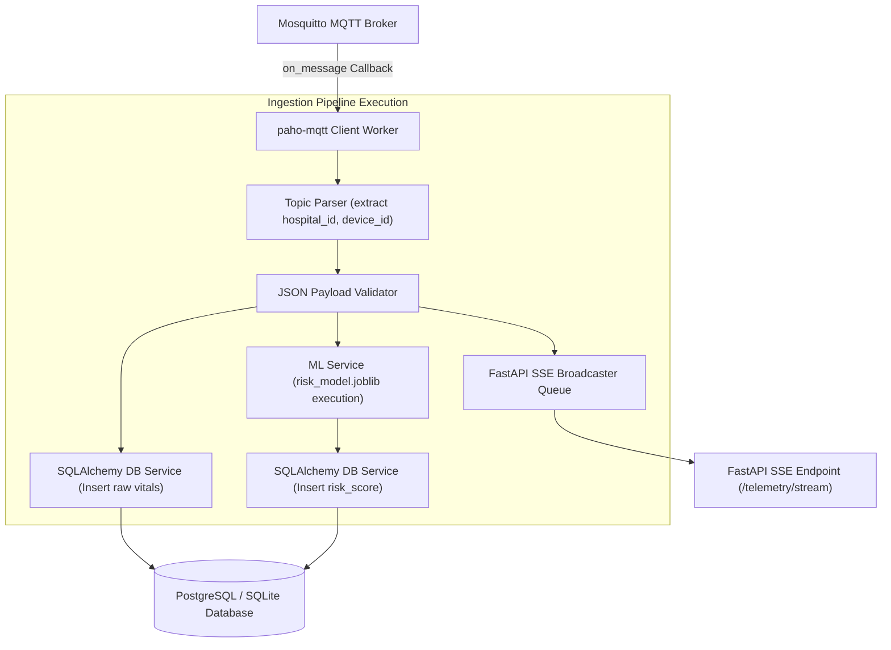

# 09 — MQTT Ingestion Architecture

> **Path:** `architecture-project/09-mqtt-ingestion-architecture.md`  
> **Status:** Implemented & Verified (Python `paho-mqtt` Client Worker)  

## Processing Flow Steps
1. **Message Reception:** `on_message` callback receives raw payload from topic `healconnect/{hospital}/{device}/vitals`.
2. **Parsing & Validation:** Extracts device ID, verifies valid numeric ranges (`HR: 30-220`, `SpO2: 50-100%`).
3. **Storage & Analytics:** Saves raw telemetry, invokes `risk_model.joblib`, and pushes updated payload to SSE stream queue.
