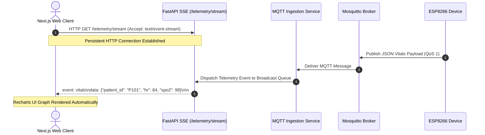

# 10 — Real-Time Server-Sent Events (SSE) Architecture

> **Path:** `architecture-project/10-realtime-sse-architecture.md`  
> **Status:** Implemented & Verified (FastAPI SSE `/telemetry/stream`)  

## Technical Justification for SSE over WebSockets
* **Unidirectional Requirement:** Client only requires receiving server-pushed telemetry updates.
* **Low Overhead:** Native HTTP transport bypasses WebSocket handshake framing complexity.
* **Auto-Reconnection:** Browser `EventSource` handles reconnection automatically upon network interruption.
