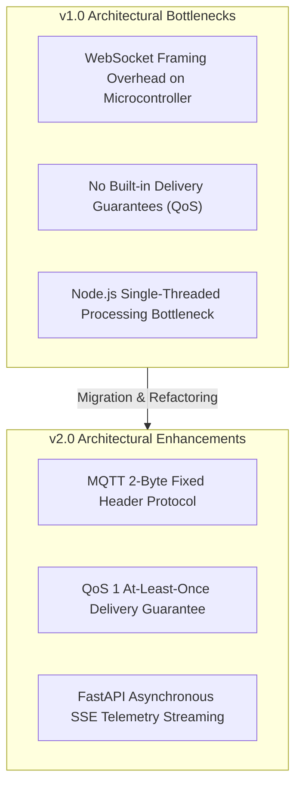

# 20 — Architecture Evolution Analysis

> **Path:** `architecture-project/20-architecture-evolution.md`  
> **Status:** Historical Migration Justification  

## Protocol Trade-off Summary

| Protocol | Header Size | Overhead on ESP8266 | QoS Guarantee | Client Subscriptions |
| :--- | :--- | :--- | :--- | :--- |
| **WebSockets (v1.0)** | 2 – 14 bytes + Frame Mask | High Memory Footprint | None (Custom Retry Required) | Bi-directional |
| **MQTT (v2.0)** | 2 bytes | Minimal Memory Footprint | **QoS 1 Native Support** | Pub/Sub via Broker |
| **HTTP SSE (v2.0)** | Standard HTTP | Zero Client Framing | Auto Reconnect | Unidirectional Server Push |
