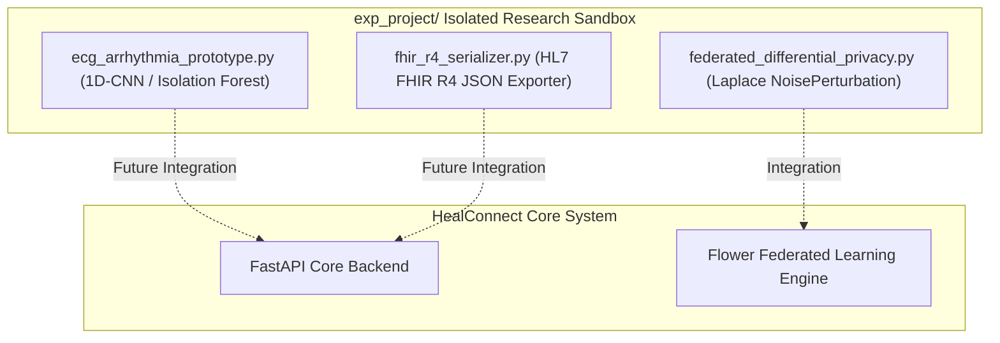

# 21 — Experimental Laboratory (`exp_project`) Architecture

> **Path:** `architecture-project/21-exp-project-architecture.md`  
> **Status:** Experimental Research Sandbox Prototypes  

## Prototype Descriptions
1. **`ecg_arrhythmia_prototype.py`:** Unsupervised anomaly detection on Lead-II waveforms via Isolation Forest.
2. **`fhir_r4_serializer.py`:** Converts internal schemas to standard HL7 FHIR R4 `Patient` and `Observation` JSON resources.
3. **`federated_differential_privacy.py`:** Implements Laplace noise parameter perturbation for $(\epsilon, \delta)$-differential privacy.
