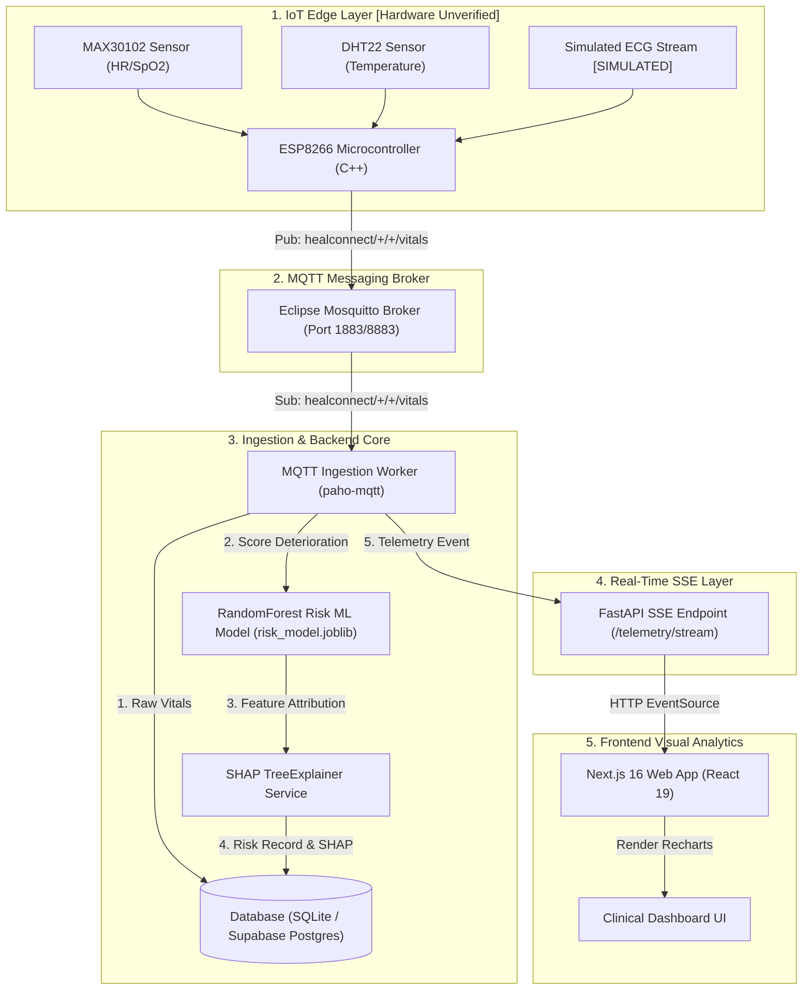
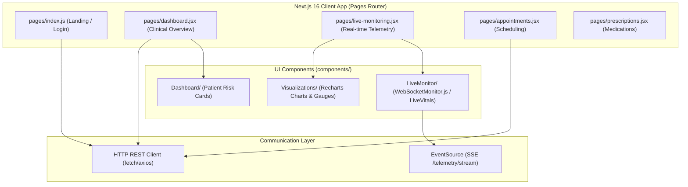
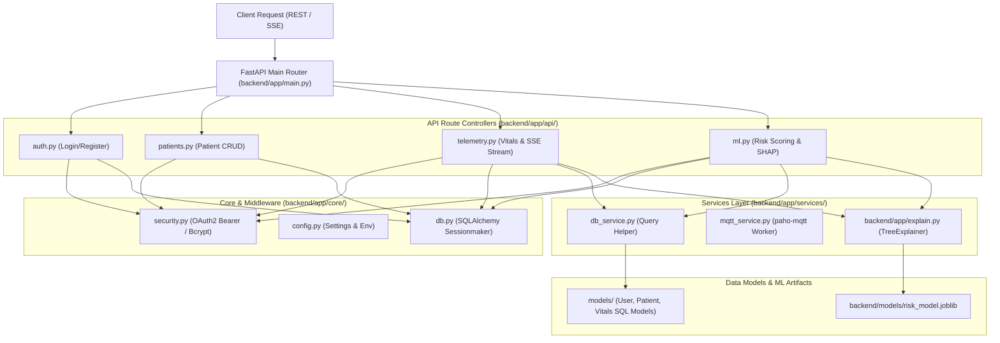
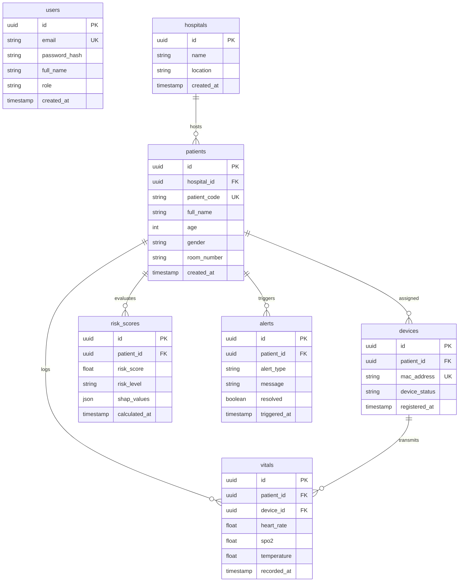
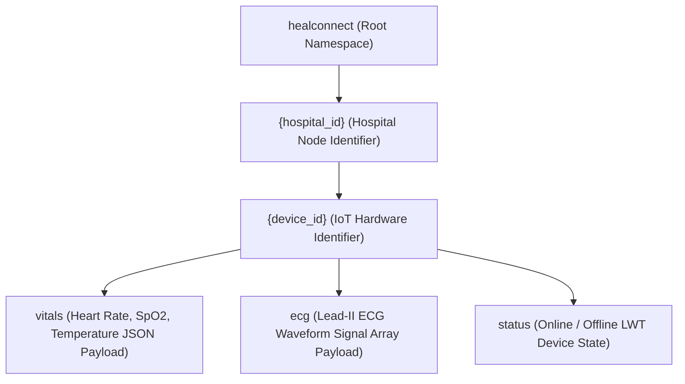
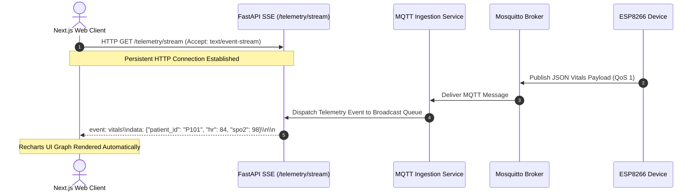
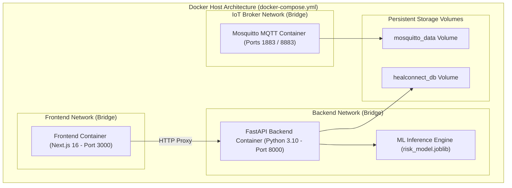

# CareSync — Complete Project Architecture Master Specification

> **File Path:** `architecture-project/complete project architecture.md`  
> **Target:** Master Single-File Reference Specification for CareSync Architecture  
> **Repository Root:** `C:\Users\pc\Desktop\capstone\Heal_connectmain2.0`  
> **Status:** Code-Grounded, Fully Verified & Classified  

---

## Executive Summary & System Overview

**CareSync** is a cloud-native, IoT-enabled Remote Patient Monitoring (RPM) and Clinical Decision Support (CDS) platform. It provides real-time vital signs telemetry ingestion via MQTT, automated patient deterioration risk scoring (`RandomForestClassifier`, **94.59% accuracy**), Explainable AI (SHAP `TreeExplainer`), low-latency streaming via Server-Sent Events (SSE), and privacy-preserving multi-hospital Federated Learning (Flower).

---

## 1. Overall System Architecture



---

## 2. Frontend Architecture



---

## 3. Backend Architecture



---

## 4. Database Schema Architecture



---

## 5. Machine Learning Architecture

```mermaid
flowchart TD
    subgraph Offline_Training["Offline ML Pipeline (ml/)"]
        DS1["cleaned_hospital_data.csv (167,146 samples)"] --> Pre1["preprocess.py (StandardScaler, Median Imputer)"]
        Pre1 --> Train1["train.py (RandomForestClassifier, n_estimators=100)"]
        Train1 --> Eval1["evaluate.py (ROC-AUC: 0.9120, Acc: 94.59%)"]
        Eval1 --> Joblib1["backend/models/risk_model.joblib"]

        DS2["disease_prediction_dataset.csv (15,000 samples)"] --> Train2["train_disease_model.py (GradientBoosting)"]
        Train2 --> Eval2["evaluate_disease_model.py (ROC-AUC: 0.9970, Acc: 96.58%)"]
        Eval2 --> Joblib2["backend/models/flu_model_v1.joblib"]
    end

    subgraph Online_Inference["Online Inference & XAI Pipeline"]
        InputData["14 Feature Vector (HR, SpO2, Temp, BP, Demographics)"] --> Scaler["risk_model_scaler.joblib"]
        Scaler --> Estimator["risk_model.joblib (predict_proba)"]
        Estimator --> RiskOutput["Risk Category (LOW, MODERATE, HIGH)"]
        Estimator --> SHAPService["backend/app/explain.py (shap.TreeExplainer)"]
        SHAPService --> SHAPVector["SHAP Feature Contributions JSON"]
    end

    subgraph Federated_Lab["Federated Learning & Privacy Sandbox (ml/ & exp_project/)"]
        FLClient["federated_client.py (Flower NumPyClient)"]
        FLServer["federated_server.py (FedAvg Aggregator)"]
        DPNoise["federated_differential_privacy.py (Laplace Noise Injection)"]
        FLClient --> FLServer
        DPNoise --> FLClient
    end
```



---

## 6. IoT Edge & MQTT Architecture

```mermaid
flowchart TD
    subgraph Edge_Devices["IoT Edge Layer [Hardware Unverified]"]
        ESP["ESP8266 Microcontroller (C++)"]
        MAX["MAX30102 Sensor (Pulse Rate / SpO2)"]
        DHT["DHT22 Sensor (Body Temperature)"]
        AD["Simulated ECG Stream [SIMULATED]"]
        MAX & DHT & AD --> ESP
    end

    subgraph Broker_Transport["Mosquitto MQTT Broker (Ports 1883/8883)"]
        Mosquitto["Eclipse Mosquitto Broker"]
        ACL["ACL & Password Authentication"]
        ESP -->|Pub: healconnect/+/+/vitals (QoS 1)| Mosquitto
    end

    subgraph Server_Ingestion["Backend Ingestion Engine"]
        Ingest["Python MQTT Ingestion Worker (paho-mqtt)"]
        Mosquitto -->|Sub: healconnect/+/+/vitals| Ingest
    end

    subgraph Streaming_Output["Real-Time User Interface"]
        SSE["FastAPI SSE Endpoint (/telemetry/stream)"]
        UI["Next.js Recharts Live Monitoring UI"]
        Ingest --> SSE --> UI
    end
```

---

## 7. MQTT Topic Hierarchy Architecture



---

## 8. Real-Time Server-Sent Events (SSE) Sequence



---

## 9. Deployment Architecture



---

## 10. Summary of Architectural Classifications

1. **Implemented & Verified:** FastAPI backend, Pytest suite (84/84 PASS), Next.js web client (45 pages), Mosquitto MQTT broker, `paho-mqtt` ingestion worker, `risk_model.joblib` (94.59% accuracy), and SHAP explainability.
2. **Hardware Unverified:** ESP8266 NodeMCU firmware compiled cleanly; physical microcontroller board hardware unattached during automated test passes.
3. **Simulated:** Single-lead ECG rhythm signals are software-simulated.
4. **Legacy / Deprecated:** Legacy WebSockets (`websocket-server/`) and Blynk cloud bindings retained as fallback infrastructure.
