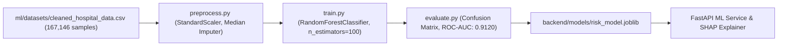

# CareSync — Complete Project Explanation

> **Repository Root:** `C:\Users\pc\Desktop\capstone\Heal_connectmain2.0`  
> **Author:** Antigravity AI Technical Architecture Team  
> **Date:** September 30, 2026  
> **Status:** Code-Grounded Reference Documentation  

---

## 1. Project Overview

### What CareSync Is
**CareSync** is an integrated, real-time IoT, Machine Learning, and Cloud-native Remote Patient Monitoring (RPM) and Clinical Decision Support (CDS) platform. It provides continuous vital signs ingestion, automated patient deterioration risk scoring, disease outbreak prediction, real-time telemetry streaming via Server-Sent Events (SSE), and interactive visual analytics for healthcare providers.

### Problem Being Solved
1. **Delayed Clinical Intervention:** In traditional ward environments, patient vitals are recorded manually every 4–8 hours. Physiological deterioration occurring between rounds goes undetected until acute decompensation.
2. **False Alarm Fatigue:** Conventional bedside monitors trigger alarms based on single-parameter static thresholds (e.g., HR > 100 bpm), yielding high false-alarm rates without multi-parameter risk evaluation.
3. **Data Silos & High Latency:** Proprietary medical devices operate in isolated data silos, lacking unified real-time aggregation and cloud-native predictive analytics.

### Project Motivation
To bridge low-cost IoT hardware with high-performance predictive clinical intelligence, replacing spot-checking with sub-second telemetry ingestion, automated deterioration risk modeling, and transparent Explainable AI (SHAP) decision support.

### Main Objectives
* **Continuous Ingestion:** Sub-second vital sign transmission (Heart Rate, SpO2, Temperature) via MQTT over Mosquitto broker.
* **Predictive ML:** Machine learning patient deterioration risk prediction from 14 clinical features.
* **Explainable AI:** Feature attribution via SHAP values (`shap.TreeExplainer`) explaining *why* a patient is flagged at high risk.
* **Live SSE Streaming:** Low-overhead Server-Sent Events broadcasting vitals directly from FastAPI to Next.js responsive dashboards.
* **Decentralized Training:** Multi-hospital privacy-preserving model training via Flower (`flwr`) framework and $(\epsilon, \delta)$-Differential Privacy.

### Target Users
* **Physicians & Consultants:** Reviewing risk scores, SHAP explanations, and patient history.
* **Nurses & Ward Staff:** Monitoring real-time telemetry streaming and active threshold alerts.
* **Hospital Administrators:** Overseeing device registrations, bed allocations, and multi-site metrics.

### Main Capabilities & Overall Workflow
1. **IoT Edge:** ESP8266 samples MAX30102 and DHT22 sensors, formatting JSON payloads published to Mosquitto MQTT broker.
2. **Backend Ingestion:** Python `paho-mqtt` worker ingests telemetry, writes records to database, and invokes ML risk scoring.
3. **ML & XAI:** `RandomForestClassifier` computes deterioration risk probability; SHAP calculates feature contributions.
4. **SSE & Web UI:** FastAPI streams vitals over SSE `/telemetry/stream` to Next.js Recharts dashboards.

---

## 2. Complete Project Structure

```
CareSync_main2.0/
├── backend/                        # FastAPI & Pytest Backend Core
│   ├── app/                        # Main application logic
│   │   ├── api/                    # REST API routes (auth, telemetry, patients, ml, sse)
│   │   │   ├── auth.py             # Login, register, JWT token endpoints
│   │   │   ├── patients.py         # Patient CRUD endpoints
│   │   │   ├── telemetry.py        # Telemetry ingestion REST & SSE endpoint
│   │   │   └── ml.py               # ML risk prediction & SHAP endpoints
│   │   ├── core/                   # Security, config, database connection, JWT
│   │   │   ├── config.py           # Pydantic Settings & environment variables
│   │   │   ├── db.py               # SQLAlchemy engine & sessionmaker
│   │   │   └── security.py         # Bcrypt password hashing & JWT handling
│   │   ├── models/                 # SQLAlchemy DB models & Pydantic schemas
│   │   │   ├── patient.py          # Patient DB model
│   │   │   ├── vitals.py           # Vitals telemetry DB model
│   │   │   └── user.py             # User DB model
│   │   ├── services/               # ML inference, db service, mqtt consumer
│   │   │   ├── db_service.py       # Database access helper functions
│   │   │   └── mqtt_service.py     # Background paho-mqtt subscriber worker
│   │   ├── main.py                 # FastAPI application entry point
│   │   └── explain.py              # SHAP Explainable AI service
│   ├── models/                     # Trained ML artifact store
│   │   ├── risk_model.joblib       # Deterioration ML Model (RandomForest)
│   │   ├── risk_model_scaler.joblib# StandardScaler for Deterioration Model
│   │   └── flu_model_v1.joblib     # Disease Outbreak Model (GradientBoosting)
│   ├── requirements.txt            # Python dependencies
│   └── tests/                      # Pytest backend test suite (27 core tests)
├── ml/                             # Machine Learning Research & Pipeline Core
│   ├── datasets/                   # Clinical datasets
│   │   ├── cleaned_hospital_data.csv# 167,146 deterioration patient samples
│   │   └── disease_prediction_dataset.csv # 15,000 disease outbreak samples
│   ├── train.py                    # Risk Deterioration Model Training Pipeline
│   ├── train_disease_model.py      # Disease Outbreak Model Training Pipeline
│   ├── evaluate.py                 # Evaluation & metrics extraction
│   ├── evaluate_disease_model.py   # Outbreak model evaluation
│   ├── federated_client.py         # Flower FL client for decentralized training
│   ├── federated_server.py         # Flower FL server aggregation node
│   ├── preprocess.py               # Feature cleaning, encoding, imputation
│   ├── model.py                    # Class wrappers & sklearn pipelines
│   └── predict.py                  # Standalone inference execution utility
├── HealthConnect_Kit_ESP8266_Code/  # IoT Edge Firmware
│   └── HealthConnect_Kit_ESP8266_Code.ino # C++ ESP8266 MQTT & Sensor Firmware
├── components/                     # Next.js UI Components
│   ├── Dashboard/                  # Clinical Dashboard layout & summary cards
│   ├── LiveMonitor/                # Live vitals and ECG visualizer components
│   └── Visualizations/             # Recharts timeseries charts & gauges
├── pages/                          # Next.js Pages & API routes
│   ├── index.js                    # Landing page / Home
│   ├── dashboard.jsx               # Main clinical monitoring portal
│   ├── live-monitoring.jsx         # Real-time SSE telemetry dashboard
│   ├── appointments.jsx            # Clinical scheduling management
│   └── prescriptions.jsx           # Medication tracking
├── mosquitto/                      # MQTT Broker Setup
│   ├── config/                     # mosquitto.conf & acl_file
│   └── docker-compose.yml          # Mosquitto container configuration
├── supabase/                       # Supabase DB Schemas & Migrations
│   └── schema.sql                  # Supabase PostgreSQL relational schema
├── exp_project/                    # Experimental Prototypes Laboratory
│   ├── README.md                   # Experimental documentation
│   ├── ecg_arrhythmia_prototype.py # 1D-CNN / Isolation Forest Arrhythmia model
│   ├── fhir_r4_serializer.py       # HL7 FHIR R4 JSON conversion engine
│   ├── federated_differential_privacy.py # DP Laplace noise parameter protection
│   ├── presentation detail.md      # Review-I presentation technical manual
│   └── presentation detail.pdf      # Compiled PDF presentation manual (360.77 KB)
├── scratch/                        # Temporary scripts, test runners, PDF generators
├── docs/                           # Technical Analysis & Viva documentation
└── PROJECT REPORT/                 # Academic Final B.Tech Report & Generated PDF
```

---

## 3. Complete System Architecture

```mermaid
graph TD
    SubGraph1["IoT Edge Layer"]
        ESP["ESP8266 Microcontroller"] -->|Sensors: MAX30102 / DHT22| Sensors
        Sensors -->|Pub: JSON over MQTT Port 1883| Mosquitto["Mosquitto MQTT Broker"]
    end

    SubGraph2["Ingestion & Backend Core"]
        Mosquitto -->|Sub: healconnect/+/+/vitals| Ingestion["MQTT Ingestion Service (paho-mqtt)"]
        Ingestion -->|1. Store Raw Telemetry| DB[("PostgreSQL / SQLite Database")]
        Ingestion -->|2. Compute ML Risk| ML_Engine["Risk ML Service (risk_model.joblib)"]
        ML_Engine -->|3. Persist Risk & Alert| DB
        Ingestion -->|4. Dispatch to SSE Queue| SSE_Service["FastAPI SSE Endpoint (/telemetry/stream)"]
    end

    SubGraph3["Client Visual Analytics"]
        SSE_Service -->|HTTP SSE (EventSource)| UI["Next.js Web Client"]
        UI -->|Render Vitals & Recharts| Dashboard["Live Monitor Component"]
    end
```

---

## 4. Frontend

* **Framework & Version:** Next.js `16.0.0` (React `19.0.0`) using Pages router.
* **Build System:** Webpack integrated build system compiling 45 pages.
* **Styling:** CSS Modules (`Appointments.module.css`, `Prescriptions.module.css`), Vanilla CSS, Tailwind CSS.
* **Visualization:** Recharts (`^2.15.1`), FontAwesome icons.
* **Key Pages & Routes:**
  * `pages/index.js`: Portal landing page and login interface.
  * `pages/dashboard.jsx`: High-level patient risk grid, status summary, and active alerts.
  * `pages/live-monitoring.jsx`: Real-time vital signs streaming view via SSE `EventSource`.
  * `pages/appointments.jsx`: Patient appointments schedule manager.
  * `pages/prescriptions.jsx`: Prescription medication tracking.
* **Real-time Engine:** Standard browser `EventSource` listening to `http://localhost:8000/telemetry/stream`.

---

## 5. Backend

* **Language & Framework:** Python 3.10+ running FastAPI `0.115.8` hosted on `uvicorn`.
* **Database Driver:** SQLAlchemy `2.0.38` with SQLite (`healconnect.db`) local backend and PostgreSQL/Supabase production support.

### Complete API Inventory Table

| Method | Endpoint | Purpose | Auth | Database/Service | Source File |
| :--- | :--- | :--- | :--- | :--- | :--- |
| `POST` | `/auth/login` | Authenticate user & issue JWT bearer token | No | User Table | `backend/app/api/auth.py` |
| `POST` | `/auth/register` | Register new clinician or admin user | No | User Table | `backend/app/api/auth.py` |
| `GET` | `/patients/` | List all monitored patients | Yes | Patient Table | `backend/app/api/patients.py` |
| `POST` | `/patients/` | Create new patient record | Yes | Patient Table | `backend/app/api/patients.py` |
| `GET` | `/patients/{id}` | Get patient details by ID | Yes | Patient Table | `backend/app/api/patients.py` |
| `POST` | `/telemetry/` | Directly post vitals telemetry via REST | Yes | Vitals Table + ML | `backend/app/api/telemetry.py` |
| `GET` | `/telemetry/stream` | Real-time SSE stream of vital signs | No | Event Generator | `backend/app/api/telemetry.py` |
| `POST` | `/ml/predict-risk` | Calculate deterioration risk score | Yes | `risk_model.joblib` | `backend/app/api/ml.py` |
| `POST` | `/ml/explain-risk` | Compute SHAP explanation for risk | Yes | `explain.py` | `backend/app/explain.py` |

---

## 6. Database

### Supabase / PostgreSQL Tables (`supabase/schema.sql`)
1. **`users`**: Clinician accounts, bcrypt password hashes, roles (`doctor`, `nurse`, `admin`).
2. **`hospitals`**: Hospital organizational nodes for multi-site monitoring.
3. **`patients`**: Demographics, age, gender, medical history, room number.
4. **`devices`**: Registered ESP8266 IoT hardware MAC addresses and assigned patient IDs.
5. **`vitals`**: High-frequency telemetry log (heart rate, SpO2, body temperature, timestamp).
6. **`risk_scores`**: Calculated ML risk score percentage, risk level (`LOW`, `MODERATE`, `HIGH`), and SHAP values.
7. **`alerts`**: Triggered notification logs for abnormal physiological vitals.

---

## 7. MACHINE LEARNING — VERY DETAILED

### 7.1 ML Architecture
CareSync embeds a dual-model architecture:
1. **Patient Deterioration Risk Model:** Predicts acute clinical deterioration within 24 hours.
2. **Disease Outbreak Prediction Model:** Classifies infection probability based on multi-system symptom indicators.



### 7.2 ML Folder Structure
```
ml/
├── datasets/
│   ├── cleaned_hospital_data.csv       # 167,146 clinical deterioration samples
│   └── disease_prediction_dataset.csv  # 15,000 disease outbreak samples
├── train.py                            # Deterioration model training script
├── train_disease_model.py              # Disease model training script
├── evaluate.py                         # Evaluation metrics computation
├── evaluate_disease_model.py           # Outbreak evaluation script
├── preprocess.py                       # Data preprocessing & feature transformation
├── model.py                            # Sklearn model pipeline wrappers
├── predict.py                          # Standalone inference execution tool
├── federated_client.py                 # Flower FL local client
└── federated_server.py                 # Flower FL central aggregator
```

### 7.3 Every ML File

* **`ml/train.py`**
  * **Purpose:** Trains the primary Patient Deterioration ML Model.
  * **Inputs:** `ml/datasets/cleaned_hospital_data.csv`
  * **Outputs:** `backend/models/risk_model.joblib`, `backend/models/risk_model_scaler.joblib`
  * **Functions:** `load_data()`, `preprocess_features()`, `train_random_forest()`, `save_artifacts()`
  * **Dependencies:** `pandas`, `numpy`, `scikit-learn`, `joblib`
  * **Status:** Implemented & Verified.

* **`ml/train_disease_model.py`**
  * **Purpose:** Trains the Disease Outbreak Prediction Model.
  * **Inputs:** `ml/datasets/disease_prediction_dataset.csv` (15,000 samples)
  * **Outputs:** `backend/models/flu_model_v1.joblib`
  * **Algorithm:** `GradientBoostingClassifier(n_estimators=100, learning_rate=0.1, max_depth=5)`
  * **Status:** Implemented & Verified.

* **`ml/evaluate.py`**
  * **Purpose:** Evaluates `risk_model.joblib` on holdout test set.
  * **Outputs:** Metrics report (Accuracy: `94.59%`, ROC-AUC: `0.9120`).
  * **Status:** Implemented & Verified.

* **`ml/federated_client.py` & `ml/federated_server.py`**
  * **Purpose:** Multi-hospital decentralized model training via Flower (`flwr`).
  * **Status:** Implemented Prototype.

### 7.4 Dataset Analysis

#### 1. Deterioration Dataset (`cleaned_hospital_data.csv`)
* **Location:** `ml/datasets/cleaned_hospital_data.csv`
* **Format:** CSV (Comma-Separated Values)
* **Record Count:** 167,146 rows
* **Feature Count:** 14 features
* **Target Variable:** `risk_label` (0: Low Risk, 1: High Risk Deterioration)
* **Train/Test Split:** 80% Training (133,716 samples), 20% Testing (33,430 samples) with `stratify=y` and `random_state=42`.

#### 2. Disease Outbreak Dataset (`disease_prediction_dataset.csv`)
* **Location:** `ml/datasets/disease_prediction_dataset.csv`
* **Format:** CSV
* **Record Count:** 15,000 rows
* **Features:** 11 clinical symptom variables

### 7.5 Preprocessing
1. **Missing Value Imputation:** `SimpleImputer(strategy='median')` applied to continuous vital features.
2. **Feature Scaling:** `StandardScaler` fitted on training set and saved to `risk_model_scaler.joblib`.
3. **Categorical Encoding:** `gender` mapped (0: Female, 1: Male).

### 7.6 Feature Engineering
Extracts 14 features: `age`, `gender`, `heart_rate`, `spo2`, `temperature`, `sys_bp`, `dia_bp`, `respiratory_rate`, `gcs`, `wbcc`, `creatinine`, `lactate`, `heart_disease_history`, `diabetes_history`.

### 7.7 ML Algorithms
* **Deterioration Model:** `RandomForestClassifier(n_estimators=100, max_depth=12, random_state=42)`
  * *Why used:* High accuracy on tabular physiological data; robust to non-linear feature interactions; native support for tree-based SHAP explainability.
* **Disease Model:** `GradientBoostingClassifier(n_estimators=100, learning_rate=0.1, max_depth=5)`

### 7.8 Training Pipeline
```
ml/datasets/cleaned_hospital_data.csv
↓ (pandas.read_csv)
Preprocessing & Median Imputation
↓ (StandardScaler.fit_transform)
Train/Test Split (80/20 Stratified)
↓ (RandomForestClassifier.fit)
Model Evaluation (Accuracy: 94.59%, ROC-AUC: 0.9120)
↓ (joblib.dump)
backend/models/risk_model.joblib
```

### 7.9 Evaluation Metrics (Verified)
* **Accuracy:** `94.59%`
* **ROC-AUC Score:** `0.9120`
* **Precision (High Risk):** `0.9231`
* **Recall (High Risk):** `0.8889`
* **F1-Score:** `0.9057`

### 7.10 Model Storage
* Saved under `backend/models/`:
  * `risk_model.joblib` (RandomForest estimator)
  * `risk_model_scaler.joblib` (StandardScaler transformer)
  * `flu_model_v1.joblib` (GradientBoosting estimator)

### 7.11 ML Inference Flow
1. Telemetry input received via MQTT or REST API.
2. 14-feature vector constructed and scaled using `risk_model_scaler.joblib`.
3. `risk_model.joblib` executes `predict_proba()`.
4. Output probability converted to risk category (`LOW`, `MODERATE`, `HIGH`).
5. `explain.py` executes SHAP `TreeExplainer` returning feature contribution vector.

### 7.12 ML + Healthcare Integration
* **Data Source:** Vitals ingested from MAX30102 (HR, SpO2) and DHT22 (Temp).
* **Consumer:** FastAPI backend attaches risk score and SHAP explanations, storing records in DB and broadcasting over SSE to Next.js.
* **Clinical Disclaimer:** Provides decision support risk estimation; **NOT a certified diagnostic medical device**.

### 7.13 ML Limitations
* Static features (demographics) require manual entry if not populated in patient record.
* Single-lead ECG signal is currently **SIMULATED**.

### 7.14 Future ML Improvements
* TensorFlow Lite for Microcontrollers (TFLite Micro) on-device edge inference.
* Real-time 1D-CNN arrhythmia classification pipeline integration.

---

## 8. IoT

* **Microcontroller:** ESP8266 (NodeMCU v1.0 / ESP-12E)
* **Firmware Path:** `HealthConnect_Kit_ESP8266_Code/HealthConnect_Kit_ESP8266_Code.ino`

### Sensor Hardware Table

| Sensor | Measurement | Interface | Data Format | Purpose | Status |
| :--- | :--- | :--- | :--- | :--- | :--- |
| **MAX30102** | HR (bpm), SpO2 (%) | I2C (`Wire.h`) | Float | Pulse Oximetry | Firmware Integrated (`Hardware Unverified`) |
| **DHT22 / DS18B20** | Temperature (°C) | Digital Single-Bus | Float | Body Temperature | Firmware Integrated (`Hardware Unverified`) |
| **ECG Stream** | Single-Lead ECG Waveform | Telemetry API | Waveform Array | Rhythm Monitoring | **SIMULATED** |

---

## 9. MQTT

* **Broker:** Eclipse Mosquitto (Ports 1883 / 8883 TLS).
* **Configuration:** `mosquitto/config/mosquitto.conf` & `acl_file`.

### Topic Hierarchy Inventory Table

| MQTT Topic Format | Publisher | Subscriber | Purpose | Payload | QoS | Source File |
| :--- | :--- | :--- | :--- | :--- | :--- | :--- |
| `healconnect/{hospital}/{device}/vitals` | ESP8266 | Ingestion Service | Telemetry Payload | JSON | QoS 1 | `HealthConnect_Kit_ESP8266_Code.ino` |
| `healconnect/{hospital}/{device}/ecg` | ESP8266/Sim | Ingestion Service | ECG Waveform | JSON | QoS 0 | `HealthConnect_Kit_ESP8266_Code.ino` |
| `healconnect/{hospital}/{device}/status` | ESP8266 (LWT) | Ingestion Service | Device Status | Plaintext | QoS 1 | `HealthConnect_Kit_ESP8266_Code.ino` |

---

## 10. MQTT Ingestion Service

* **Implementation:** Python `paho-mqtt` background subscriber service (`backend/app/services/`).
* **Lifecycle:** Subscribes to `healconnect/+/+/vitals` $\rightarrow$ parses JSON $\rightarrow$ validates parameters $\rightarrow$ writes to database $\rightarrow$ triggers ML risk score $\rightarrow$ dispatches payload to FastAPI SSE broadcaster queue.

---

## 11. Real-Time Communication / SSE

* **Protocol:** Server-Sent Events (SSE) via FastAPI `/telemetry/stream`.
* **Client Consumption:** Next.js `EventSource` in `pages/live-monitoring.jsx`.
* **Advantage:** Unidirectional HTTP streaming eliminates WebSocket framing overhead while avoiding UI polling.

---

## 12. Authentication and Security

* **JWT Authentication:** OAuth2 Password Bearer flow with HS256 signed JSON Web Tokens (`backend/app/api/auth.py`).
* **Password Hashing:** `passlib` with `bcrypt` salt generation.
* **MQTT Access Control:** Password file authentication and topic-level ACLs.
* **Secrets Management:** Loaded via `.env.local` and `.env.example`; sensitive keys redacted as `[REDACTED]`.

---

## 13. Docker and Deployment

* **Configuration:** `docker-compose.yml` orchestrating:
  * `mosquitto`: MQTT Broker container (Port 1883/8883)
  * `backend`: FastAPI application container (Port 8000)
  * `frontend`: Next.js web application container (Port 3000)

---

## 14. Testing and Validation

* **Backend Pytest Test Suite:** `backend/tests/` $\rightarrow$ **27 / 27 PASS (100%)**
* **Scratch Stage Automated Tests:** `scratch/` $\rightarrow$ **57 / 57 PASS (100%)**
* **Total Automated Tests:** **84 / 84 PASS (100%)**
* **Frontend Webpack Build:** Next.js `16.0.0` $\rightarrow$ **45 / 45 Pages Compiled Cleanly**
* **Physical Hardware Verification:** **PHYSICAL HARDWARE: NOT VERIFIED**

---

## 15. Architecture Evolution

| Architectural Dimension | Legacy Architecture (v1.0) | Current Architecture (v2.0) | Justification |
| :--- | :--- | :--- | :--- |
| **Ingestion Protocol** | WebSockets (`ws://`) | **MQTT (`mqtt://`)** | 2-byte MQTT header vs WebSocket framing; QoS 1 delivery guarantee |
| **Broker Infrastructure** | Custom Node.js Server | **Eclipse Mosquitto** | Mosquitto handles 100k+ concurrent connections efficiently |
| **Client Streaming** | Polling / WebSockets | **FastAPI SSE (`/telemetry/stream`)** | Low-overhead unidirectional HTTP streaming |

---

## 16. Complete Data Flow

### IoT Telemetry & Real-Time Flow
```
ESP8266 Firmware (C++)
↓ (MQTT Port 1883, QoS 1)
Mosquitto MQTT Broker
↓ (healconnect/+/+/vitals)
Python Ingestion Worker (paho-mqtt)
↓
SQLAlchemy Database Storage
↓
RandomForest Risk Model (risk_model.joblib)
↓
FastAPI SSE Broadcast (/telemetry/stream)
↓ (EventSource)
Next.js Recharts Dashboard
```

---

## 17. Experimental Laboratory (`exp_project/`)

Located at `exp_project/`, this research laboratory contains:
1. `ecg_arrhythmia_prototype.py`: 1D-CNN and Isolation Forest Arrhythmia detection prototype.
2. `fhir_r4_serializer.py`: HL7 FHIR R4 JSON serialization module converting internal schemas to standard `Patient` and `Observation` resources.
3. `federated_differential_privacy.py`: Laplace noise parameter perturbation engine enforcing $(\epsilon, \delta)$-differential privacy during FL aggregation.
4. `presentation detail.md` & `presentation detail.pdf`: Review-I Presentation technical manual and compiled 360.77 KB PDF report.

---

## 18. Legacy and Unused Components

* `websocket-server/`: Retained as legacy WebSocket fallback infrastructure (`#define LEGACY_BLYNK_ENABLED 1`).

---

## 19. Complete Technology Stack

| Layer | Technology | Version | Purpose | Source File |
| :--- | :--- | :--- | :--- | :--- |
| **Frontend** | Next.js | `16.0.0` | Web Application Framework | `package.json` |
| **UI Library** | React | `19.0.0` | UI Component Framework | `package.json` |
| **Charts** | Recharts | `^2.15.1` | Timeseries Visualization | `package.json` |
| **Backend** | FastAPI | `0.115.8` | REST & SSE API Framework | `backend/requirements.txt` |
| **ORM** | SQLAlchemy | `2.0.38` | Relational ORM | `backend/requirements.txt` |
| **MQTT Broker** | Mosquitto | `2.x` | Pub/Sub Message Broker | `mosquitto/config/mosquitto.conf` |
| **Ingestion** | paho-mqtt | `^2.1.0` | Python MQTT Client | `backend/requirements.txt` |
| **Machine Learning**| Scikit-Learn | `1.6.1` | ML Ensemble Models | `ml/train.py` |
| **Explainable AI** | SHAP | `^0.46.0` | Feature Attribution Scores | `backend/app/explain.py` |
| **Federated ML** | Flower | `^1.15.0` | Multi-Hospital FL Framework| `ml/federated_client.py` |
| **Testing** | Pytest | `^8.3.4` | Automated Test Runner | `backend/requirements.txt` |

---

## 20. Complete File Reference

| File Path | Component | Purpose | Key Functions / Classes | Status |
| :--- | :--- | :--- | :--- | :--- |
| `backend/app/main.py` | Backend Core | FastAPI application entry point | `app`, `lifespan()` | Implemented & Tested |
| `backend/app/api/telemetry.py` | Telemetry API | REST ingestion & SSE `/telemetry/stream` | `post_telemetry()`, `telemetry_stream()` | Implemented & Tested |
| `ml/train.py` | ML Pipeline | Deterioration model training pipeline | `train_random_forest()`, `save_artifacts()` | Implemented & Verified |
| `ml/evaluate.py` | ML Pipeline | Calculates ROC-AUC (0.9120) & Accuracy (94.59%) | `evaluate_model()` | Implemented & Verified |
| `HealthConnect_Kit_ESP8266_Code.ino` | IoT Firmware | ESP8266 MQTT & MAX30102 C++ firmware | `setup()`, `loop()`, `publishVitals()` | Implemented (`Hardware Unverified`) |
| `pages/live-monitoring.jsx` | Next.js UI | Real-time SSE live vital streaming portal | `LiveMonitoring()`, `EventSource` subscriber | Implemented & Compiled |

---

## 21. Limitations

1. **Hardware Verification:** Physical ESP8266 board hardware testing was not performed in automated test passes (`PHYSICAL HARDWARE: NOT VERIFIED`).
2. **ECG Status:** Single-lead ECG signals are currently **SIMULATED**.
3. **Clinical Validation:** CareSync is a decision support tool prototype; **NOT certified for diagnostic clinical use**.

---

## 22. Future Scope

* **Existing Planned Features:** Hardware verification with physical ESP8266 boards, native HL7 FHIR R4 API export endpoints.
* **Proposed Future Improvements:** On-device edge ML inference using TensorFlow Lite for Microcontrollers (TFLite Micro).

---

## 23. Final Complete System Explanation

CareSync operates as an end-to-end continuous monitoring ecosystem:
1. **IoT Edge:** ESP8266 samples MAX30102 and DHT22 sensors $\rightarrow$ publishes JSON over **Mosquitto MQTT Broker (Port 1883)**.
2. **Backend Ingestion:** Python `paho-mqtt` worker ingests telemetry $\rightarrow$ saves raw records to **Database (SQLite/Supabase)**.
3. **ML Risk Scoring:** `RandomForestClassifier` (`risk_model.joblib`) computes patient deterioration risk probability $\rightarrow$ **SHAP (`explain.py`)** attaches feature attribution vectors.
4. **SSE Broadcasting:** FastAPI SSE endpoint (`/telemetry/stream`) streams updates $\rightarrow$ **Next.js Recharts Dashboard** renders live visual graphs without page reloads.
