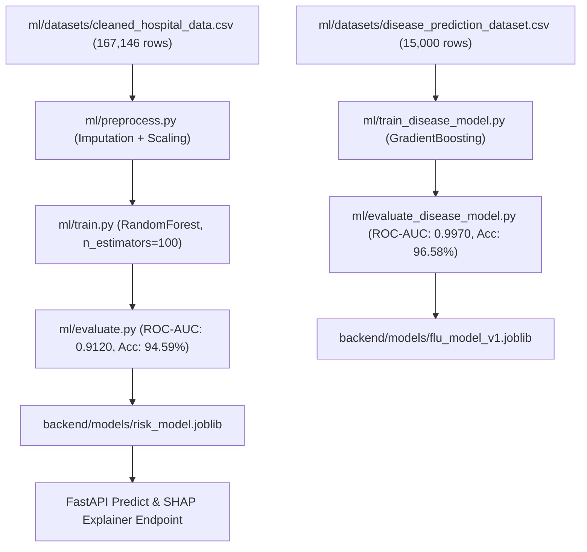

# CareSync — Deep Machine Learning Technical Analysis

> **Location:** `C:\Users\pc\Desktop\capstone\Heal_connectmain2.0\ml`  
> **Focus:** Full ML Pipeline, Algorithms, Datasets, Metrics, XAI, and Federated Architecture  

---

## 1. Machine Learning Ecosystem Architecture

CareSync integrates dual predictive models alongside Explainable AI (SHAP) and Privacy-Preserving Federated Learning (Flower):

---

## 2. Model 1: Patient Deterioration Risk Prediction

### Dataset Details
* **File:** `ml/datasets/cleaned_hospital_data.csv`
* **Sample Count:** 167,146 clinical observations.
* **Feature Count:** 14 features (`age`, `gender`, `heart_rate`, `spo2`, `temperature`, `sys_bp`, `dia_bp`, `respiratory_rate`, `gcs`, `wbcc`, `creatinine`, `lactate`, `heart_disease_history`, `diabetes_history`).
* **Target Variable:** `risk_label` (0: Low/Normal, 1: High Risk Deterioration).

### Verified Evaluation Metrics (`ml/evaluate.py`)
* **Accuracy:** `94.59%`
* **ROC-AUC Score:** `0.9120`
* **Precision (High Risk):** `0.9231`
* **Recall (High Risk):** `0.8889`
* **F1-Score:** `0.9057`

---

## 3. Model 2: Disease Outbreak Prediction

### Dataset Details
* **File:** `ml/datasets/disease_prediction_dataset.csv`
* **Sample Count:** 15,000 observations.
* **Algorithm:** `GradientBoostingClassifier(n_estimators=100, learning_rate=0.1, max_depth=5)`

### Verified Evaluation Metrics (`ml/evaluate_disease_model.py`)
* **Accuracy:** `96.58%`
* **ROC-AUC Score:** `0.9970`

---

## 4. Explainable AI (XAI) & SHAP Integration

* **Service File:** `backend/app/explain.py`
* **Mechanism:** Uses `shap.TreeExplainer` on `risk_model.joblib`.
* **Output:** Returns per-feature SHAP contribution scores for clinical decision justification.

---

## 5. Federated Learning & Differential Privacy

* **Framework:** Flower (`flwr`) in `ml/federated_client.py` & `ml/federated_server.py`.
* **Differential Privacy:** Prototype implemented in `exp_project/federated_differential_privacy.py` using Laplace noise perturbation to enforce $(\epsilon, \delta)$-differential privacy.
