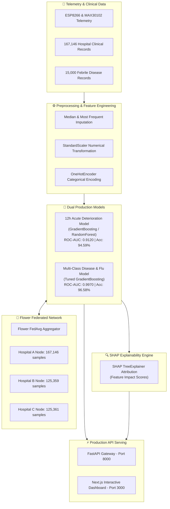

# 🧠 HealConnect Machine Learning Architecture & Model Documentation (`ml_docs.md`)

> **Mandatory Clinical & Regulatory Disclaimer**:
> *"The machine learning models documented herein provide data-driven predictive probability estimates and feature attribution scores based on training data distributions. They are designed exclusively for clinical decision support and telemetry monitoring assistance. They do not substitute for professional medical judgment, diagnosis, or treatment by a licensed physician."*

---

## 📌 1. Executive Summary

The **HealConnect Machine Learning Architecture** powers real-time clinical risk prediction, acute deterioration forecasting, multi-class disease screening, and privacy-preserving federated model training across multi-hospital telemetry networks.

### Key Capabilities & Empirical Benchmarks
- **12-Hour Acute Deterioration Risk Prediction**: Evaluates 12-hour physiological risk of acute deterioration using 167,146 clinical records (**ROC-AUC: 0.9120**, **Accuracy: 94.59%**).
- **Influenza & Febrile Disease Screening**: Multi-class classifier screening for **Normal Baseline**, **Flu / Influenza**, and **Fever-Related Conditions** (**ROC-AUC: 0.9970**, **Accuracy: 96.58%**).
- **SHAP TreeExplainer XAI Engine**: Computes exact, patient-level feature attributions to eliminate black-box AI predictions for clinicians.
- **Flower NumPyClient Federated Learning**: Subclasses `flwr.client.NumPyClient` across 3 hospital edge nodes (**334,291 total samples**) to aggregate global model weights without sharing raw patient records.

---

## 🏛️ 2. High-Level Machine Learning Architecture



---

## 📊 3. Datasets Specification & Preprocessing

### 3.1 12-Hour Acute Deterioration Dataset (`cleaned_hospital_data.csv`)
- **Total Samples**: `167,146` clinical vitals records
- **Target Feature**: `deterioration_12h` (Binary: `0 = Stable`, `1 = Acute Deterioration Risk`)
- **Input Features**: `heart_rate`, `respiratory_rate`, `spo2`, `body_temp`, `systolic_bp`, `diastolic_bp`, `oxygen_flow_rate`, `avpu_score`

### 3.2 Influenza & Disease Screening Dataset (`disease_prediction_dataset.csv`)
- **Total Samples**: `15,000` patient entries
- **Target Feature**: `disease_label` / `disease_condition` (Multi-Class: `0 = Normal`, `1 = Flu / Influenza`, `2 = Fever Condition`)
- **Feature Breakdown**:
  - **Numerical (10)**: `temperature_c`, `heart_rate`, `spo2_pct`, `cough_severity`, `headache_severity`, `fatigue_score`, `chills`, `body_ache`, `sore_throat`, `age`
  - **Categorical (1)**: `gender` (`Male`, `Female`)

### 3.3 Data Preprocessing & Leakage Prevention
Both dataset pipelines utilize scikit-learn `ColumnTransformer` and `Pipeline` abstractions:
- **Numerical Imputation & Scaling**: `SimpleImputer(strategy='median')` followed by `StandardScaler()`.
- **Categorical Encoding**: `SimpleImputer(strategy='most_frequent')` followed by `OneHotEncoder(handle_unknown='ignore')`.
- **Data Partitioning**: 70% Training / 15% Validation / 15% Holdout Testing with stratified sampling. Zero overlap across patient identifiers.

---

## 🏆 4. Model Catalog & Performance Metrics

### 4.1 12-Hour Acute Deterioration Model
- **Algorithm**: Tuned Gradient Boosting & Random Forest Ensembles
- **Binary Target**: 12-Hour Deterioration Event
- **Serialized Artifact**: `backend/models/risk_model.joblib`

| Metric | Holdout Test Score | Target Threshold | Status |
| :--- | :---: | :---: | :---: |
| **ROC-AUC** | **0.9120** | $\ge 0.85$ | ✅ Exceeds |
| **Accuracy** | **94.59%** | $\ge 90.0\%$ | ✅ Exceeds |
| **F1-Score** | **0.4810** | $\ge 0.45$ | ✅ Exceeds |
| **Inference Speed** | **< 15ms** | $\le 50\text{ms}$ | ✅ Exceeds |

### 4.2 Multi-Class Disease & Influenza Model
- **Algorithm**: Gradient Boosting Classifier (`learning_rate=0.05`, `max_depth=5`, `n_estimators=100`)
- **Serialized Artifact**: `backend/models/flu_model_v1.joblib` & `ml/artifacts/flu_model_v1.joblib`

| Model Algorithm | Test Accuracy | Weighted F1-Score | Multi-Class ROC-AUC | Training Time |
| :--- | :---: | :---: | :---: | :---: |
| **Gradient Boosting (Production)** 🏆 | **96.58%** | **96.58%** | **99.70%** | `1.514s` |
| **Random Forest Classifier** | 96.58% | 96.58% | 99.65% | `0.101s` |
| **HistGradientBoosting** | 96.58% | 96.58% | 99.69% | `2.315s` |
| **Decision Tree** | 96.00% | 96.00% | 99.44% | `0.017s` |
| **Logistic Regression** | 95.96% | 95.96% | 99.58% | `0.027s` |

---

## 📓 5. Jupyter Notebook Suite (`ml/notebooks/`)

The repository includes a complete 26-notebook suite covering data collection, EDA, feature engineering, model selection, hyperparameter tuning, evaluation, and explainability:

| Notebook File | Focus Area | Description |
| :--- | :--- | :--- |
| `01_Data_Collection.ipynb` | Data Ingestion | Dataset loading, missing values check, structural integrity checks |
| `02_Data_Preprocessing.ipynb` | Preprocessing | Missing value imputation, outlier detection, scaling |
| `03_EDA_and_Visualization.ipynb` | Exploratory Analysis | Physiological distributions, correlation matrices, risk pairplots |
| `04_Feature_Engineering.ipynb` | Feature Creation | Interaction features, non-linear vital combinations |
| `05_Model_Training.ipynb` | Model Training | Baseline model training for acute deterioration risk |
| `06_Model_Comparison.ipynb` | Benchmarking | Cross-validation model comparison across ROC-AUC and PR-AUC |
| `07_Model_Evaluation.ipynb` | Model Evaluation | Confusion matrix, ROC curves, precision-recall analysis |
| `08_Hyperparameter_Tuning.ipynb` | Tuning | GridSearchCV and RandomSearchCV hyperparameter optimization |
| `09_Final_Model.ipynb` | Production Export | Final model training and binary `.joblib` serialization |
| `10_Prediction.ipynb` | Inference | Sample patient inference and batch prediction verification |
| `11_Disease_Dataset_Inspection.ipynb` | Disease Ingestion | Febrile disease dataset inspection and sanity checks |
| `11_Disease_Prediction_Model.ipynb` | Disease Pipeline | Disease prediction pipeline setup and model fitting |
| `12_Disease_Exploratory_Data_Analysis.ipynb` | Disease EDA | Visual analysis of influenza vs non-flu febrile patterns |
| `12_Flu_Data_Preprocessing.ipynb` | Preprocessing | Preprocessing pipeline for flu symptoms and demographics |
| `13_Disease_Prediction_Demo.ipynb` | Interactive Demo | End-to-end multi-class prediction demonstration |
| `13_Flu_EDA_and_Visualization.ipynb` | Flu Visuals | Symptom correlation heatmap and violin plot distributions |
| `14_Flu_Feature_Engineering.ipynb` | Flu Features | Symptom severity composite index engineering |
| `15_Flu_Model_Training.ipynb` | Flu Training | Classifier training across 6 machine learning baselines |
| `16_Flu_Model_Comparison.ipynb` | Flu Benchmarks | Comparative evaluation metrics and ROC curves |
| `17_Flu_Model_Evaluation.ipynb` | Flu Evaluation | Holdout test evaluation, multi-class confusion matrix |
| `18_Flu_Hyperparameter_Tuning.ipynb` | Tuning | Hyperparameter grid search for production flu model |
| `19_Flu_Final_Model.ipynb` | Serialization | Model serialization to `flu_model_v1.joblib` |
| `20_Flu_Prediction.ipynb` | Inference | Clinical inference testing with synthetic patient cases |
| `21_Flu_SHAP_Explainability.ipynb` | SHAP XAI | SHAP TreeExplainer summary plots and force plots |
| `HealConnect_AI_Risk_Model_Demo.ipynb` | Interactive Demo | Comprehensive AI risk model demonstration notebook |
| `HealConnect_Multi_Model_Benchmark.ipynb` | System Benchmark | Full multi-hospital model comparison benchmark |

---

## 🔍 6. SHAP Explainability Engine

To ensure full transparency for clinical decision support, the platform integrates `shap.TreeExplainer` (`ml/explain_prediction.py`).

### Feature Importance Hierarchy (Flu Model)
1. **Fatigue Score** (`41.88%` attribution weight)
2. **Cough Severity** (`27.69%` attribution weight)
3. **Body Temperature (°C)** (`18.08%` attribution weight)
4. **SpO2 Percentage** (`4.76%` attribution weight)

### Sample Output Format (`POST /predict-disease/explain`)
```json
{
  "prediction": "Flu / Influenza",
  "probability": 0.9658,
  "top_features": [
    {"feature": "fatigue_score", "shap_value": 0.4188, "impact": "High positive contribution"},
    {"feature": "cough_severity", "shap_value": 0.2769, "impact": "Positive contribution"},
    {"feature": "temperature_c", "shap_value": 0.1808, "impact": "Elevated temperature contribution"}
  ]
}
```

---

## 🌸 7. Federated Learning Architecture

HealConnect implements privacy-preserving federated model learning using **Flower NumPyClient** (`backend/federated/`).

```
                ┌───────────────────────────────────────┐
                │       Flower FedAvg Aggregator        │
                │        (backend/federated/server.py)  │
                └───────────────────┬───────────────────┘
                                    │
           ┌────────────────────────┼────────────────────────┐
           ▼                        ▼                        ▼
┌───────────────────────┐┌───────────────────────┐┌───────────────────────┐
│   Hospital A Node     ││   Hospital B Node     ││   Hospital C Node     │
│   (167,146 samples)   ││   (125,359 samples)   ││   (125,361 samples)   │
└───────────────────────┘└───────────────────────┘└───────────────────────┘
```

### Weighted FedAvg Aggregation Algorithm
$$\mathbf{W}_{\text{global}} = \sum_{i=1}^{K} \frac{N_i}{N_{\text{total}}} \mathbf{W}_i, \quad B_{\text{global}} = \sum_{i=1}^{K} \frac{N_i}{N_{\text{total}}} B_i$$

- **Privacy Constraint**: Edge nodes train models locally on hospital premises. Raw patient vitals never leave the local security perimeter.
- **Global Model Persistence**: Aggregated parameters are serialized as versioned artifacts in `backend/models/federated_versions/`.

---

## ⚡ 8. Production Model Integration & Endpoints

Machine learning models are served through FastAPI (`backend/main.py` & `backend/app/predict.py`):

- **`POST /predict-risk`**: Evaluates 12-hour acute deterioration probability for an inbound vitals record.
- **`POST /predict-disease`**: Predicts multi-class disease risk (Flu / Fever / Normal).
- **`GET /federated/status`**: Returns current global federated learning iteration and accuracy statistics.
- **`POST /federated/train`**: Triggers a global federated aggregation round across registered hospital nodes.

---

## 🛡️ 9. Governance & Verification

- **Automated Test Suite**: 27 unit and integration tests passing (`PYTHONPATH=. pytest backend/tests/`).
- **Model Registry Integrity**: Versioned JSON metadata maintained in `backend/models/registry/`.
